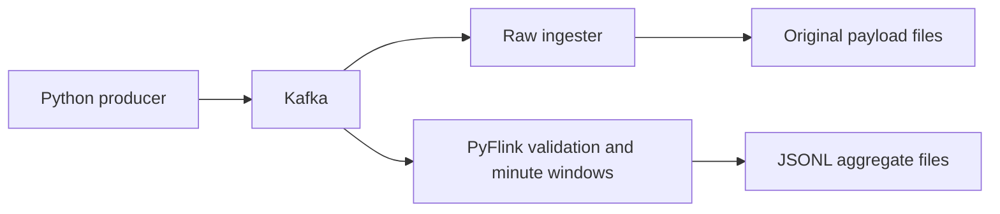

# Pageview streaming pipeline

A local Python pipeline that publishes synthetic pageviews to Kafka, archives the original payloads and uses PyFlink to count pageviews by postcode in one-minute event-time windows.

## Run locally

Start with the **[PowerShell walkthrough](docs/DEMO_POWERSHELL.md)** or **[Bash walkthrough](docs/DEMO_BASH.md)**. Each covers startup, live traffic, inspecting results, tests and shutdown. Commands run from the repository root.

You need Docker with Linux containers, Compose supporting `up --wait` and `wait`, and roughly 4 GiB of available Docker memory plus build headroom. The images target Linux x86-64. No host Python or Java is needed for the pipeline; local tests need Python 3.11. The first build can take several minutes. Windows with Docker Desktop and Git Bash have been verified; native Linux/WSL execution remains unverified.

| View | Local address |
| --- | --- |
| Flink job and checkpoints | [localhost:8081](http://127.0.0.1:8081) |
| Optional Kafka browser | [localhost:8080](http://127.0.0.1:8080) |
| Optional Grafana dashboard | [localhost:3000](http://127.0.0.1:3000/d/streaming-demo) |

These ports, Kafka's `9092` and optional Prometheus port `9090` must be available when starting the corresponding services.

## Design choices

I used independent Kafka consumers so raw archival preserves every original payload, including invalid records, while Flink validates and aggregates separately. Events contain exactly `user_id`, `postcode`, `webpage` and an epoch-seconds `timestamp`; values are not normalised or enriched.

Flink groups valid events by postcode and UTC minute, allowing five seconds of disorder. Records for closed windows are excluded with diagnostics. Finished JSONL files contain `postcode`, `window_start` and `pageview_count` and become visible after a successful checkpoint. If traffic stops, the final minute can remain open until later event times advance the watermark.

I chose local files to make byte preservation and results easy to inspect. Raw files and aggregates live in separate directories under `data/`. Default safeguards limit publishing to 15 minutes and raw archival to 10,000 files or 100 MiB, with a 1 GiB free-space reserve. See the [settings and overrides](docs/LOCAL_REFERENCE.md#local-run-safeguards).

## Verification and production considerations

The tests cover validation, timestamp boundaries, raw byte preservation and a real Kafka/Flink scenario with independently specified counts. The walkthroughs include unit, Kafka integration and end-to-end commands. CI is planned; broader crash/recovery behaviour has not been verified.

This is a bounded local demonstration with a single broker and no authentication or TLS. For sustained or production use, I would replace per-record archives with rolled, byte-preserving storage, define retention, test checkpoint recovery and replay, and add broker resilience, access controls and operational alerts. There is no pipeline-wide exactly-once guarantee.

For more detail: [local command reference](docs/LOCAL_REFERENCE.md), [engineering rationale](docs/ENGINEERING_GUIDE.md), [specification](SPEC.md) and [roadmap](ROADMAP.md). The optional [Agent Forge investigation demo](docs/AGENT_FORGE_DEMO.md) is separate from the core pipeline and requires its own local setup.
