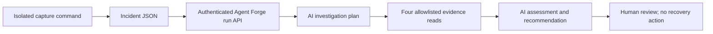

# Read-only archive incident investigation

This controlled failure uses a separate Kafka topic, consumer group, container and archive directory. It does not change or stop the healthy raw ingester or Flink job. No code defect is introduced: the archive safeguard correctly rejects its third record when configured with a two-file limit.



## 1. Capture a real failure

Use Git Bash at the stream-challenge repository root, with Kafka running and the existing application image built. The host Python environment needs the project's normal dependencies.

```bash
export MSYS_NO_PATHCONV=1
.venv/Scripts/python.exe demos/archive_incident.py capture
```

Expect `PASS: 3 published, 2 byte-exact archives, offset 2 uncommitted, exit code 1`. The command prints the incident path. Set `incident_dir` to its containing directory:

```bash
incident_dir=data/incidents/archive-limit-REPLACE_WITH_PRINTED_ID
```

The capture preserves `incident.json`, `evidence.json`, a prepared `workflow.json` with the incident selected as its default trigger preset, and the two raw files. It removes only its generated container, topic and group. Next committed offset 2 means offsets 0 and 1 were committed; record 2 was blocked. After cleanup, that temporary Kafka record is no longer available for replay. This is historical evidence, not a live recovery target.

## 2. Connect the local evidence service

The local Agent Forge checkout is assumed to be `../agentforge`, with its existing Python 3.12 environment, Node dependencies, migrated SQLite database and local login already prepared. Use its `docs/LOCAL_DEVELOPMENT.md` and `docs/AI_POC.md` for first-time setup. Nothing in this demo provisions cloud services.

In the same Git Bash terminal, create temporary credentials without printing them:

```bash
export INCIDENT_TOOLS_TOKEN="$(.venv/Scripts/python.exe -c 'import secrets; print(secrets.token_urlsafe(40))')"
export API_ACCESS_TOKEN="$(.venv/Scripts/python.exe -c 'import secrets; print(secrets.token_urlsafe(40))')"
export AGENTFORGE_API_TOKEN="$API_ACCESS_TOKEN"
export INCIDENT_TOOLS_URL=http://127.0.0.1:8011
export AI_MAX_CALLS_PER_STAGE=1
export AI_MAX_CALLS_PER_RUN=2
export AI_MAX_OUTPUT_TOKENS=2048
export CORS_ORIGINS=http://localhost:5173,http://127.0.0.1:5173
export SQLITE_PATH=../agentforge/.local/agentforge.db
export PYTHONPATH=../agentforge/apps/api
unset SQL_SERVER SQL_IDENTITY_CLIENT_ID
```

The API also needs a configured `OPENAI_API_KEY` in this shell. If necessary, enter it without echoing or putting it in shell history:

```bash
read -r -s -p 'OpenAI API key: ' OPENAI_API_KEY
export OPENAI_API_KEY
```

Start only when ports 8000 and 8011 are free; do not replace an existing Agent Forge session. These background processes inherit the same temporary credentials:

```bash
.venv/Scripts/python.exe -u demos/archive_incident.py serve "$incident_dir" > "$incident_dir/tools-server.log" 2>&1 &
tools_pid=$!
../agentforge/.venv/Scripts/python.exe -m app.migrate
../agentforge/.venv/Scripts/python.exe -m uvicorn app.main:app --app-dir ../agentforge/apps/api --host 127.0.0.1 --port 8000 > "$incident_dir/api-server.log" 2>&1 &
api_pid=$!
```

Wait for `Application startup complete` in `api-server.log`. The evidence service listens only on loopback port 8011. It reads one fixed snapshot loaded at startup, permits only matching incident/job arguments and rejects unauthenticated requests or unsupported tools. It has no shell, Docker, arbitrary-file or mutation endpoint.

## 3. Submit the investigation through the API

The command below is the API trigger: it sends an authenticated POST to `/api/workflows/{workflow_id}/runs` with the captured incident as explicit `input`. Writing the incident file alone does not trigger a run.

This explicitly starts a paid investigation, capped at two model calls. The existing Agent Forge model configuration applies. There are no automatic model-call retries.

```bash
.venv/Scripts/python.exe demos/archive_incident.py submit "$incident_dir"
```

The command binds the captured incident to the reusable `demos/archive-investigation.json` template, writes the prepared `workflow.json`, and saves that workflow through the authenticated API. Its configuration contains a default trigger preset named **Captured archive file-limit failure**, including both `incident` and `available_tools`. The API invocation pins version 1 and supplies that same payload explicitly. It reports the run ID and saves `submission.json` plus `investigation.json` under the incident directory. Repeating the command for the same folder reads the saved run rather than creating another one; server idempotency keys also bind a retry to the same incident. Preserve the folder when retrying after an uncertain response.

The workflow uses the existing `incident_plan`, `collect_incident_evidence` and `incident_assessment` contracts. The planner must request all four discovery tools once; AI forms hypotheses and purposes and can order these bounded checks. The collector executes them serially:

| Tool | Recorded evidence |
| --- | --- |
| `jobs.get_definition` | Python archiver, two-file limit and commit-after-write policy |
| `jobs.get_run` | Exit code, three inputs, two archived files, blocked/committed offsets and cleanup state |
| `jobs.get_log_excerpt` | Bounded real structured logs, including `ingestion_failed` |
| `jobs.get_related_runs` | The isolated run's scope, without claiming healthy-system status |

These are captured observations served through the mock-tool interface, marked `synthetic=true` with recorded-demo provenance. They are not live Kafka/Flink queries. The existing collector records cloud table/storage checks as unavailable; no resources are invented. The assessment cites recorded evidence IDs, recommends human review and stops. It cannot restart, delete, modify code, send Slack messages or create a PR.

## 4. View in Agent Forge

Start the UI using its existing local guide, or run this in a separate Git Bash terminal at stream-challenge root:

```bash
VITE_API_BASE_URL=http://127.0.0.1:8000 npm --prefix ../agentforge/apps/web run dev -- --host 127.0.0.1 --port 5173 --strictPort
```

Open `http://127.0.0.1:5173` and sign in using the existing local account.

To run from the designer:

1. Open the saved **Pageview archive investigation** workflow, using the workflow ID from `submission.json` to distinguish earlier verification workflows.
2. Reopen/reload its latest saved version if an older draft is already open. The prepared workflow includes a default trigger preset; the locally verified workflow was updated to version 2 without changing its existing version-1 run.
3. Select the Manual trigger and confirm **Captured archive file-limit failure** is the selected payload preset. Its content includes `incident.id`, `incident.job_name`, `incident.job_run_id`, `incident.region` and the read-only tool catalogue.
4. Validate the workflow. If an explicit next-run JSON override is present, clear that override or use the same incident payload; an empty `{}` override replaces the preset and causes missing-incident errors.
5. Choose **Run**. This starts a new investigation with up to two paid AI calls. The evidence service must still serve the same incident folder.

Opening the designer does not reuse a previous run's input automatically. Saved trigger presets provide that default; the API trigger supplies it explicitly. Inspecting an old run in Run history and repeating the CLI submit for its existing folder do not create a new run.

In Run history, select the returned run and show the planner's hypotheses, recorded tool calls, evidence references, final recommendation and model usage. A successful workflow means the investigation ran, not that the archiver recovered.

Review the report critically. The first verification run correctly identified the file limit but overstated whether the cleaned-up Kafka record remained available. The evidence now explicitly reports cleanup and next-offset semantics. AI recommendations still require human review.

## 5. Stop only the investigation services

Stop the UI with Ctrl+C in its terminal. In the original terminal, stop the two background processes started there:

```bash
kill "$api_pid" "$tools_pid"
unset AGENTFORGE_API_TOKEN API_ACCESS_TOKEN INCIDENT_TOOLS_TOKEN OPENAI_API_KEY
```

On Windows, confirm ports 8000 and 8011 have stopped; use the process's own terminal or Task Manager if a native child remains. Do not stop the stream-challenge Compose stack. Investigation history remains in Agent Forge's local SQLite database, and captured evidence remains under `data/incidents/`.

## DQ is separate from this failure

This scenario uses three valid pageviews and demonstrates an operational guard, not a data-quality defect. Flink separately rejects malformed JSON, missing/extra fields, wrong types, blank location/page values and invalid/future timestamps. It counts/logs `invalid_event` while raw ingestion preserves the original bytes. Events for closed windows are counted/logged as `late_event` and excluded from aggregates. Neither currently creates incidents automatically. A DQ-triggered investigation and file watcher remain later work.
