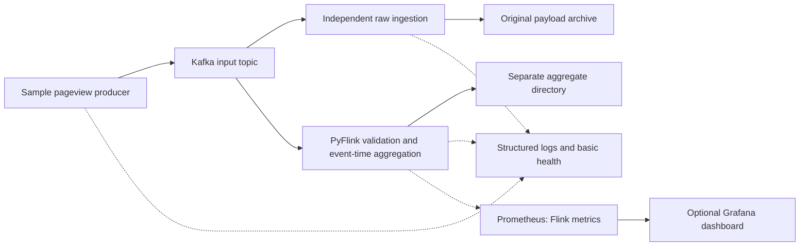

# Engineering guide

This is the central guide to design choices and AI-assisted development. Kafka, the producer and raw ingester are reviewed. The Flink baseline was agreed on 31 October 2026 and its implementation is verified locally, awaiting review. The diagram shows the full pipeline.

## Architecture

Python, Kafka, PyFlink, Docker Compose, local storage, pytest and GitHub Actions are agreed choices. Raw ingestion and aggregation are independent. Direct aggregate output from Flink is preferred over an extra topic.

The brief permits multiple broker, storage and streaming options. Kafka, PyFlink and local files are our choices, rather than technologies dictated by traffic volume. This route does not require AWS, Kinesis, S3, LocalStack or Terraform. Keep the local topology small. Production resilience is separate from this design.

Local execution is the initial deliverable. Keep processing independent of deployment endpoints and prefer supported connectors, but do not claim that cloud deployment is a configuration-only change. Cloud provisioning is outside the current scope.

## Local infrastructure

Implemented in `compose.yaml`: one combined KRaft broker/controller using `apache/kafka:4.3.2`, a persistent named data volume and a one-shot initializer for `pageviews`. Automatic topic creation is disabled. The topic has one partition, replication factor 1, one-day/256 MiB segment retention, 16 MiB segments and an hourly roll interval. Retention is enforced during segment cleanup, not as a strict disk cap. Broker heap is limited to 512 MiB; this is not a container memory limit. Docker logs rotate at 10 MiB with three files.

Separate advertised listeners support host clients (`127.0.0.1:9092`) and Compose services (`kafka:29092`). Only the host listener is published, restricted to loopback. The explicit IPv4 address fixes native Python failures when Windows resolves `localhost` to IPv6. Plaintext and replication factor 1 suit this local exercise, with no authentication or broker redundancy claimed. The fixed cluster ID is a non-secret local identifier.

The patched Kafka 4.3.2 JVM image is pinned instead of `latest`; [Apache's release list](https://kafka.apache.org/community/downloads/) and [versioned Docker example](https://github.com/apache/kafka/blob/4.3.2/docker/examples/docker-compose-files/single-node/plaintext/docker-compose.yml) informed the choice. Kafka documents [client/broker compatibility](https://kafka.apache.org/41/getting-started/compatibility/); actual Flink integration is checked separately in milestone 3.

Milestone 1 verified startup/readiness, initialization, broker round trips, persistence and reset on Windows using Docker Engine 29.9.2 and Compose 5.6.0. The independent broker smoke check remains in `tests/integration/kafka-smoke-test.sh`.

## Producer and raw ingestion

The engineer selected per-record files for the local exercise. `archive.py` stores value bytes at `<root>/<topic>/<partition>/<offset>.bin`, with separate empty `.null` markers for null values. This keeps inspection and byte fidelity simple, including malformed records, at the cost of many small files. Batched archives would need framing and more recovery logic; revisit that choice before sustained production use rather than building it speculatively.

The three default-on local safeguards are publishing duration, archive file/byte budgets and a free-space reserve. Their settings and explicit opt-out are documented in the [README](../README.md#local-run-safeguards). They use the existing processes and Python standard library, without a daemon, automatic deletion or compaction. The archive scans existing files once, tracks successful new files and periodically reads free space. Replays do not consume the budget twice, and a rejected new write cannot commit its Kafka offset. These checks assume one writer per archive root; they are not a distributed quota or strict filesystem allocation limit.

Local simplicity does not justify an archive that grows indefinitely. Per-record storage remains a bounded demo choice. Rolled batches preserving original payload bytes, defined retention and tested recovery are required before extended-volume or production use, including any S3 extension. This is an explicit readiness gate. Cloud object capacity alone does not settle request overhead, small-object efficiency or commit semantics. Generated output in a synchronised folder also needs consideration in the sustained-run storage plan.

Each file is written to a temporary path, flushed and fsynced, then atomically renamed before a synchronous Kafka offset commit. Auto-commit and automatic offset storage are disabled. A failure after writing but before committing can replay the record; matching files are reused and conflicting contents fail without overwriting evidence. This is at-least-once consumption with file reuse, not a transaction across Kafka and storage. Parent-directory durability, power loss and concurrent writers to the same archive root are not guaranteed or tested. A hard stop may leave ignored `.tmp` files.

Keep an archive root tied to one topic generation and use one consumer group for its writers. Recreating Kafka can reuse offsets, so use a new archive root after a broker reset. Removing files while retaining committed offsets requires a new group/replay of retained Kafka data to rebuild the archive.

The producer uses broker acknowledgements and idempotent publishing, waiting for delivery reports record by record. This is deliberately straightforward at the expected volume; it trades throughput for simple failure reporting. A timeout or interruption can leave delivery uncertain, so repeating a command is not guaranteed to avoid duplicate business events. Fixed or seeded random intervals and continuous mode are demo controls. The interval is added between acknowledged sends, not a guaranteed event rate.

The main live demonstration uses three existing one-minute pacing configurations, moving from low to busy to medium traffic. A repeating 3:2:1 postcode mix gives different counts with the same four source fields. The phases use current event timestamps and are independent of UTC window boundaries. One verified run published 200, 639 and 385 records, 1,224 in total. Nine committed aggregate rows counted 994 pageviews; the final open minute held the remaining 230. Raw files preserved all 1,224 new payloads. This is a short visibility demonstration, not a sustained-volume or production load test.

An optional `inspect` profile provides [Kafbat UI 1.5.0](https://github.com/kafbat/kafka-ui/releases/tag/v1.5.0) on loopback port 8080. It uses Kafka's existing listener, read-only cluster mode and disabled dynamic configuration, with bounded Docker logs and a 384 MiB JVM heap. No pipeline component depends on it. Message offsets and consumer lag support inspection; broker byte-rate charts need metrics that this local broker does not expose. The browser's read-only setting is not broker authentication or a production access-control design. JSON message viewing and live mode were checked in the browser; the cluster API confirmed read-only mode.

Python 3.11, `confluent-kafka==2.16.1` and `pytest==9.2.0` are used for this milestone. The client provides native Windows/Linux wheels and ordinary Kafka access without a Confluent service. [Client documentation](https://docs.confluent.io/kafka-clients/python/current/overview.html) describes delivery callbacks and offset management; the [API reference](https://docs.confluent.io/platform/current/clients/confluent-kafka-python/html/index.html) distinguishes synchronous commits. Dependencies are pinned in `pyproject.toml`; the container uses Python 3.11.18 and runs as a non-root user. The host virtual environment uses the already-installed Python 3.11.2.

Application logs use Python's standard logging module with a readable coloured console formatter and a selectable JSON formatter. Console level badges have contrasting backgrounds; success and lifecycle display labels do not introduce custom logging severities. `LOG_FORMAT=json` removes ANSI codes for automation, and `LOG_COLOUR` controls console colour detection. No extra logging dependency is needed. The [README](../README.md#log-display) documents the palette and settings.

Core unit tests run locally without Docker. Four Kafka integration checks exercise the real Python commands, byte fidelity (including null/empty/repeated values), retry after a filesystem failure and an archive-limit stop without committing the blocked offset. A Docker demo verified host-visible archive files and variable pacing; continuous production was manually stopped with Ctrl+C. The producer checks required field types; it does not introduce postcode/URL normalisation or further business validation. Raw ingestion deliberately does not parse or reject payloads. Flink DQ handling is now verified in milestone 3; broad crash/recovery evidence remains milestone 5 work.

## Technical decisions

The following baseline is agreed and verified locally. Published compatibility informed selection; the continuous streaming scenario supplies runtime evidence.

| Decision | Agreed baseline and trade-off |
| --- | --- |
| Sustained archival readiness | Before extended-volume or production/S3 use, select a byte-preserving batch container, rolling/visibility policy, retention and recovery behaviour. Demonstrate bounded file growth and replay correctness. The current per-record demo and local guards do not satisfy that gate. |
| PyFlink API and versions | DataStream validation, timestamp assignment, native window aggregation and late side output. Table/SQL would shorten the count query but complicate explicit DQ handling. A table connector exposes raw bytes and Kafka metadata, then hands records to DataStream; this avoids custom Java deserialisation. Python 3.11, Flink/PyFlink 2.2.1, Java 17 and Kafka connector `5.0.0-2.2` are verified together with the existing Kafka broker. |
| Aggregate sink and schema | Built-in FileSink writes JSONL part files containing `postcode`, `window_start` (UTC text ending in `Z`) and `pageview_count`. The end is implicitly one minute later. Files roll on ten-second checkpoints; only finished files are readable results. This favours clarity over Parquet efficiency and production file sizing. |
| Event-time policy | UTC tumbling minute windows, start inclusive and end exclusive; configurable five-second disorder tolerance, zero additional allowed lateness. Exclude records for closed windows with diagnostics, preserving their raw archive. Final-only results avoid correction/upsert semantics. If all input stops, the final window remains pending until later valid event times advance the watermark. Do not replace event time with wall-clock closure. |
| Flink checkpoints and delivery | Ten-second checkpoints on the local persistent bind mount; automatic restarts disabled initially so failures remain visible. Verify checkpoint completion and finished-file visibility now, broader recovery in milestone 5. Fresh submissions read retained input from earliest offsets and require empty output/checkpoint directories; Kafka offsets alone cannot restore window state. No pipeline-wide exactly-once claim. |
| Validation | Exactly four fields and required types, excluding booleans as integers; reject blank postcode/webpage strings without trimming valid strings. UTC-representable epoch seconds (years 1-9999), with configurable five-minute future allowance. Historical timestamps, partial postcodes, scheme-less URLs and integer identifiers of either sign remain valid. Reject before watermark assignment; count/log safe reasons and Kafka coordinates. |
| Local setup | One JobManager, one TaskManager and a submission client, with parallelism 1. Shared local `data/` mount for aggregates/checkpoints, loopback Flink UI on port 8081. JVM process budgets are 1 GiB and 2 GiB; allow additional memory for Python workers, Kafka and Docker. These are not container memory quotas. |
| Test completion and CI | Exercise an unbounded Kafka source. Observe running state and checkpoint-committed output with bounded polling. Include explicitly accounted-for later events to close earlier windows; assert the final quiet minute stays pending. A committed earlier window establishes when to inject a deliberately late event. General scenario harness/CI work remains in milestones 4 and 7. |

## Correctness and testing

Milestone 3 verification passed 59 native unit tests, four Kafka integration checks and one continuous Kafka/Flink scenario. The scenario uses 13 records: eight valid and five invalid (malformed JSON, invalid UTF-8, empty bytes, null and a future timestamp). Four completed postcode/window results account for six pageviews; one valid event is excluded as late and one stays in the final open window. Every original payload is independently archived unchanged. A later successful checkpoint during silence confirms that checkpointing does not force event-time closure. Tests cancel their job and remove their own topic, groups and files. Windows cleanup handles read-only flags on Docker-created folders in the synchronised workspace.

The focused milestone 4 increment replaces the later in-process archival check with a separate raw-ingester Docker container. It waits for Flink tasks and raw application readiness before publishing, checks the first 11 raw files while Flink is running, then checks the finite raw process's successful exit and all 13 payloads. Progress messages, explicit aggregate rows and a reconciliation line make the scenario suitable for a demonstration. On 1 November 2026, the concurrent scenario passed against the real Docker services on Windows, including all aggregate/DQ assertions and cleanup. The 59 unit cases and four Kafka checks also passed. Native Linux execution and broader recovery tests remain unverified.

Runtime checks exposed version-specific checkpoint and serialisation details, and showed that Flink's existing Python forwarding handler needs our formatter to preserve diagnostic fields. Aggregate throughput uses the file writer's existing `numRecordsIn` metric; validation and late exclusions have small application counters. These are live operational signals, not durable audit totals.

Base DQ requirements live in [SPEC.md](../SPEC.md#base-data-quality-requirements). Keep their implementation small: validation functions, structured diagnostic counts and independent checks in the scenario harness. No additional DQ framework, service or Kafka topic is needed by the current scope. The raw archive is required to preserve rejected payloads; a separate quarantine store would need a demonstrated reason.

The agreed DQ baseline accepts the supplied partial postcode and scheme-less webpage. Its future-clock allowance protects watermarks; it is a configurable project assumption, not a requirement from the brief. It does not reject historical test fixtures. Generic traffic anomaly thresholds and ongoing reconciliation services are later enhancements. Diagnostic counters are operational signals rather than durable audit totals; scope assertions to known runs and test recovery separately.

Preserve Kafka payload bytes without parsing and serialising them again. Test whitespace, Unicode and line breaks. Agree malformed/null payload handling and any archive framing before claiming recovery or byte fidelity.

Event timestamps are epoch seconds. Under the agreed UTC boundary convention, window start is `60 * floor(timestamp / 60)` and end is start + 60. Internal millisecond conversion must preserve that meaning. Postcode counts are pageview counts, not distinct-user counts. An incremental count accumulator avoids storing every pageview in window state.

Out-of-order input may still belong to an open window. Watermarks express progress assumptions, not proof that all records arrived. Idle-input detection can unblock active partitions but does not itself guarantee closure when all input stops. Validate timestamps before they influence watermarks.

Identical payloads do not establish duplicate business events because there is no event ID. Compare counts and record multiplicity, not sets. Kafka offsets can identify replays without changing source fields.

A scenario defines its name, input events, expected raw output, expected aggregates and expected validation/errors. The harness prepares isolated resources, publishes to Kafka, exercises the real streaming application, waits for observable results, compares records, reports and cleans up even after failure. Use explicit expected values rather than a second aggregation implementation. On timeout, capture useful progress and safe diagnostics.

Unit tests cover validation, timestamp conversion and applicable window calculations. Integration tests cover Kafka connectivity, publishing/consumption, Flink and files. Scenario coverage includes normal input, minute boundaries, multiple postcodes, invalid/missing values, out-of-order/late events and quiet streams. Add recovery cases as persistence policies are agreed.

Checkpoint state, Kafka offsets and external file commits are different boundaries. Verify restart behaviour and finished-file visibility before claiming durability or duplicate-free output. Independent consumers do not provide an atomic transaction across raw and aggregate output. Local disk storage does not protect against disk loss.

## AI-assisted development

Start from the requirement and acceptance criteria. AI can research alternatives and suggest changes; the engineer selects the design and reviews the result.

1. Agree the specification and a small milestone scope before implementation.
2. Use test-first development where practical for validation and processing logic.
3. Implement the simplest readable change, with minimal dependencies.
4. Challenge generated code: inspect assumptions, boundary cases, failure paths and connector behaviour.
5. Run relevant checks against independently specified expectations. Passing tests do not validate assumptions shared by the code and tests.
6. Update documentation and report evidence, limitations and unresolved issues. Keep proposed production improvements distinct from local capabilities.
7. The engineer reviews and commits. AI must not commit, push, create/merge PRs or manufacture history.

Use clear comments and accurate explanations. Do not disguise AI assistance or introduce deliberate mistakes. Milestone 1 showed why the README must separately wait for initializer completion. Milestone 2 exposed IPv6 resolution failures in native Windows clients and showed that shutdown must include application profiles. The README now uses an explicit IPv4 address and enables all profiles for shutdown. Record further lessons with supporting evidence as milestones finish.

## Observability and production considerations

Start with structured logs, errors, job health, consumer progress and output inspection. Even low traffic can conceal a stuck watermark or failed writer. Avoid logging payloads by default.

The optional `monitoring` profile uses Flink's bundled [Prometheus reporter](https://nightlies.apache.org/flink/flink-docs-release-2.2/docs/deployment/metric_reporters/) on internal port 9249, Prometheus 3.15.1 and Grafana 13.3.0. There is no custom exporter or application dependency. [File provisioning](https://grafana.com/docs/grafana/latest/administration/provisioning/) supplies the datasource and read-only dashboard without manual setup. Grafana permits anonymous viewing on loopback only; this is a local demo configuration, not a production security design.

The dashboard selects a job ID so independent runs do not mix. It shows reporter availability separately from running jobs and registered workers, source throughput, validated throughput, DQ counts, rows reaching the aggregate writer and completed/failed checkpoints and duration. The source uses Flink's existing rate meter; validated throughput uses `rate()` on the existing increment-only Python counter. Flink exports counters as Prometheus gauges, but these application counters only increase within an attempt. Rates handle resets; totals are operational and not durable audit evidence. Untouched Python DQ counters may be absent, so DQ panels show zero alongside explicit availability and health panels.

Writer input is not proof of committed output. Event-time postcode counts remain in files, and the scenario test verifies them independently. Prometheus scrapes every five seconds and retains one day or 256 MB of blocks, excluding additional head/WAL overhead; Grafana state is disposable. Both have bounded Docker logs. Monitoring can be stopped without stopping the pipeline. It adds memory overhead, but no new dependency between processing and monitoring.

Local verification on 1 November 2026: the concurrent 13-record scenario passed with monitoring enabled in Flink, including exporter counts of eight valid, five invalid and one late event. Both Prometheus targets were UP and all 13 dashboard queries returned data. A further paced run published 742 records across 30/45/30-second low/busy/medium phases; committed output and checkpoint progress were visible. Stopping both monitoring services left the same Flink job running; restarting them restored scraping and provisioning. Two startup checkpoint triggers were skipped while Python tasks initialised, then completed checkpoints advanced without further failures. These are local observations, not a load or recovery guarantee.

A later authorised increment adds [Kafka Exporter 1.10.0](https://github.com/danielqsj/kafka_exporter/tree/v1.10.0), internal port 9308, with a Kafka 4.0 protocol setting verified against our 4.3.2 broker. Filters restrict collection to `pageviews` and the two demo groups; inactive groups are included because Flink uses explicit assignment. No new host port or application dependency is added. The dashboard shows exporter availability and committed-offset lag separately. Missing or uninitialised offsets are excluded, rather than shown as zero. Lag is independent of the selected Flink job ID, can remain after a job stops and is not window completeness. Raw ingestion commits after archival; Flink commits after checkpoints, so short-lived lag is expected. The Kafka browser and CLI provide independent offset inspection. A 120-record paced check observed positive lag for both groups and catch-up to zero after production stopped. Both committed offsets and the broker end offset were 2511 in the independent Kafka CLI check. All 15 dashboard queries returned data, including both lag series.

Broker JMX metrics, raw-ingester throughput, alerts, log collection and tested recovery monitoring are not included in this increment. Flink UI and logs remain the source of processing error detail. No labels based on users, postcodes or URLs are added. Low traffic still benefits from visibility: a healthy broker can coexist with a failed job or a watermark that never closes its final window.

Production improvements are not implemented or required locally. Measure peaks, skew, state, lag, file counts and disk growth before scaling. Host failure tolerance would require resilient broker/storage/checkpoint arrangements and tested restoration. Real-data use would also require privacy, retention, authentication, access control and secret-management decisions, with explicit cost review for cloud services.

## Deferred incident demonstration

After a healthy tested baseline, an optional separate branch can introduce a controlled data-quality defect. Exercise a previously uncovered scenario and detect the issue through independent validation or monitoring. Agent Forge would collect safe logs, metrics and relevant source, identify a likely root cause and recommend a fix and regression test. Human approval must precede a fix branch or PR; existing agent Git restrictions still apply. No integration or fault injection is authorised now.

## Technical discussion and references

Be ready to explain why event time suits delayed visits, why raw ingestion is independent, how the API choice affects readability, how tests observe completion, what recovery guarantees were demonstrated and what production requirements would change the design. Support answers with actual decisions and test results as they become available.

Version selection used Apache's [connector compatibility list](https://flink.apache.org/downloads/), [PyFlink installation requirements](https://nightlies.apache.org/flink/flink-docs-release-2.2/docs/dev/python/installation/) and [Kafka connector metadata](https://nightlies.apache.org/flink/flink-docs-release-2.2/docs/connectors/table/kafka/). The versioned [file sink](https://nightlies.apache.org/flink/flink-docs-release-2.2/docs/connectors/datastream/filesystem/), [watermark](https://nightlies.apache.org/flink/flink-docs-release-2.2/docs/dev/datastream/event-time/generating_watermarks/) and [Python window](https://nightlies.apache.org/flink/flink-docs-release-2.2/docs/dev/python/datastream/operators/windows/) documentation informed the implementation. Successful local checks establish the scope of our claims; documentation alone does not establish recovery guarantees.
