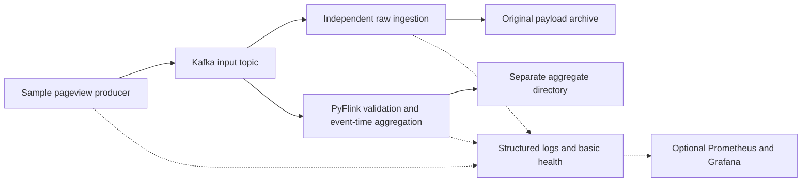

# Engineering guide

This is the central guide to design choices and AI-assisted development. The specification and local route are agreed. Kafka, the producer and raw ingester are implemented; Flink aggregation is still proposed. The diagram shows the intended full pipeline.

## Architecture

Python, Kafka, PyFlink, Docker Compose, local storage, pytest and GitHub Actions are agreed choices. Raw ingestion and aggregation are independent. Direct aggregate output from Flink is preferred over an extra topic.

The brief permits multiple broker, storage and streaming options. Kafka, PyFlink and local files are our choices, rather than technologies dictated by traffic volume. This route does not require AWS, Kinesis, S3, LocalStack or Terraform. Keep the local topology small. Production resilience is separate from this design.

Local execution is the initial deliverable. Keep processing independent of deployment endpoints and prefer supported connectors, but do not claim that cloud deployment is a configuration-only change. Cloud provisioning is outside the current scope.

## Local infrastructure

Implemented in `compose.yaml`: one combined KRaft broker/controller using `apache/kafka:4.3.2`, a persistent named data volume and a one-shot initializer for `pageviews`. Automatic topic creation is disabled. The topic has one partition, replication factor 1, one-day/256 MiB segment retention, 16 MiB segments and an hourly roll interval. Retention is enforced during segment cleanup, not as a strict disk cap. Broker heap is limited to 512 MiB; this is not a container memory limit. Docker logs rotate at 10 MiB with three files.

Separate advertised listeners support host clients (`127.0.0.1:9092`) and Compose services (`kafka:29092`). Only the host listener is published, restricted to loopback. The explicit IPv4 address fixes native Python failures when Windows resolves `localhost` to IPv6. Plaintext and replication factor 1 suit this local exercise, with no authentication or broker redundancy claimed. The fixed cluster ID is a non-secret local identifier.

The patched Kafka 4.3.2 JVM image is pinned instead of `latest`; [Apache's release list](https://kafka.apache.org/community/downloads/) and [versioned Docker example](https://github.com/apache/kafka/blob/4.3.2/docker/examples/docker-compose-files/single-node/plaintext/docker-compose.yml) informed the choice. Kafka documents [client/broker compatibility](https://kafka.apache.org/41/getting-started/compatibility/); this is a basis for later version selection, not a verified Flink integration. Select and test the Python/Flink/JVM/connector combination in milestone 3. No Flink services are installed yet.

Milestone 1 verified startup/readiness, initialization, broker round trips, persistence and reset on Windows using Docker Engine 29.9.2 and Compose 5.6.0. The independent broker smoke check remains in `tests/integration/kafka-smoke-test.sh`.

## Producer and raw ingestion

The engineer selected per-record files for the local exercise. `archive.py` stores value bytes at `<root>/<topic>/<partition>/<offset>.bin`, with separate empty `.null` markers for null values. This keeps inspection and byte fidelity simple, including malformed records, at the cost of many small files. Batched archives would need framing and more recovery logic; revisit that choice before sustained production use rather than building it speculatively.

The three default-on local safeguards are publishing duration, archive file/byte budgets and a free-space reserve. Their settings and explicit opt-out are documented in the [README](../README.md#local-run-safeguards). They use the existing processes and Python standard library, without a daemon, automatic deletion or compaction. The archive scans existing files once, tracks successful new files and periodically reads free space. Replays do not consume the budget twice, and a rejected new write cannot commit its Kafka offset. These checks assume one writer per archive root; they are not a distributed quota or strict filesystem allocation limit.

Local simplicity does not justify an archive that grows indefinitely. Per-record storage remains a bounded demo choice. Rolled batches preserving original payload bytes, defined retention and tested recovery are required before extended-volume or production use, including any S3 extension. This is an explicit readiness gate. Cloud object capacity alone does not settle request overhead, small-object efficiency or commit semantics. Generated output in a synchronised folder also needs consideration in the sustained-run storage plan.

Each file is written to a temporary path, flushed and fsynced, then atomically renamed before a synchronous Kafka offset commit. Auto-commit and automatic offset storage are disabled. A failure after writing but before committing can replay the record; matching files are reused and conflicting contents fail without overwriting evidence. This is at-least-once consumption with file reuse, not a transaction across Kafka and storage. Parent-directory durability, power loss and concurrent writers to the same archive root are not guaranteed or tested. A hard stop may leave ignored `.tmp` files.

Keep an archive root tied to one topic generation and use one consumer group for its writers. Recreating Kafka can reuse offsets, so use a new archive root after a broker reset. Removing files while retaining committed offsets requires a new group/replay of retained Kafka data to rebuild the archive.

The producer uses broker acknowledgements and idempotent publishing, waiting for delivery reports record by record. This is deliberately straightforward at the expected volume; it trades throughput for simple failure reporting. A timeout or interruption can leave delivery uncertain, so repeating a command is not guaranteed to avoid duplicate business events. Fixed or seeded random intervals and continuous mode are demo controls. The interval is added between acknowledged sends, not a guaranteed event rate.

Python 3.11, `confluent-kafka==2.16.1` and `pytest==9.2.0` are used for this milestone. The client provides native Windows/Linux wheels and ordinary Kafka access without a Confluent service. [Client documentation](https://docs.confluent.io/kafka-clients/python/current/overview.html) describes delivery callbacks and offset management; the [API reference](https://docs.confluent.io/platform/current/clients/confluent-kafka-python/html/index.html) distinguishes synchronous commits. Dependencies are pinned in `pyproject.toml`; the container uses Python 3.11.18 and runs as a non-root user. The host virtual environment uses the already-installed Python 3.11.2.

Application logs use Python's standard logging module with a readable coloured console formatter and a selectable JSON formatter. Console level badges have contrasting backgrounds; success and lifecycle display labels do not introduce custom logging severities. `LOG_FORMAT=json` removes ANSI codes for automation, and `LOG_COLOUR` controls console colour detection. No extra logging dependency is needed. The [README](../README.md#log-display) documents the palette and settings.

Core unit tests run locally without Docker. Four Kafka integration checks exercise the real Python commands, byte fidelity (including null/empty/repeated values), retry after a filesystem failure and an archive-limit stop without committing the blocked offset. A Docker demo verified host-visible archive files and variable pacing; continuous production was manually stopped with Ctrl+C. The producer checks required field types; it does not introduce postcode/URL normalisation or further business validation. Raw ingestion deliberately does not parse or reject payloads. Flink DQ handling and broad crash/recovery evidence remain for later milestones.

## Technical decisions

Selected producer/archive choices are recorded above; the remaining application decisions below stay open. Specific watermark delays, idle timeouts and checkpoint intervals are intentionally unset.

| Decision | Alternatives and recommendation for review |
| --- | --- |
| Sustained archival readiness | Before extended-volume or production/S3 use, select a byte-preserving batch container, rolling/visibility policy, retention and recovery behaviour. Demonstrate bounded file growth and replay correctness. The current per-record demo and local guards do not satisfy that gate. |
| PyFlink API and versions | Table/SQL makes grouping concise; DataStream provides explicit validation and late-event control. Evaluate which meets the agreed policies with the least code. Check a compatible released Python/JVM/Flink/Kafka/connector set before pinning versions. |
| Aggregate sink and schema | Prefer a built-in Flink file sink over custom append/recovery logic. JSONL is easy to inspect; CSV and Parquet are alternatives. The required content is postcode, window datetime and count. Proposed fields are `postcode`, `window_start`, `window_end` and `pageview_count`. Agree whether datetime is represented as UTC text or epoch seconds, whether both boundaries are useful, and how files roll and become committed. These are derived output fields, not source fields. |
| Event-time policy | Propose UTC minute boundaries, start inclusive and end exclusive. Agree disorder tolerance, idle-input handling and whether late records are dropped with diagnostics or update earlier results. Corrections complicate append-only output. A quiet stream may not advance event time enough to close its last window. |
| Flink checkpoints and delivery | Review checkpoint storage/interval, sink commit behaviour and restart limits. Producer acknowledgements and raw write/offset ordering are recorded above. Do not promise pipeline-wide exactly once. |
| Validation | Enforce required types without treating booleans as integers. Agree extra fields, empty values, numeric/timestamp ranges, malformed records and diagnostics. Accept the supplied partial postcode and scheme-less webpage. Full postcode validation, scheme requirements and non-negative limits are not stated requirements. |
| Remaining local setup | Kafka has one broker/partition and a persistent Docker volume; raw files use a verified host bind mount. Flink parallelism 1 is a candidate. Agree aggregate/checkpoint mounts, archive retention and resource budgets with their milestones. |
| Test completion and CI | Compare bounded Kafka inputs with observable continuous-job completion. Use the same processing logic as the real application. Bounded tests alone do not establish continuous or idle-stream behaviour. Agree readiness, deadlines, watermark observations and runner limits. |

## Correctness and testing

Base DQ requirements live in [SPEC.md](../SPEC.md#base-data-quality-requirements). Keep their implementation small: validation functions, structured diagnostic counts and independent checks in the scenario harness. No additional DQ framework, service or Kafka topic is needed by the current scope. The raw archive is required to preserve rejected payloads; a separate quarantine store would need a demonstrated reason.

Recommend rejecting blank postcode/webpage strings, while accepting the supplied partial postcode and scheme-less webpage. Agree this policy and timestamp representability/future-skew limits before implementation. Do not use a current-date freshness rule that rejects historical test fixtures. Generic traffic anomaly thresholds and ongoing reconciliation services are later enhancements, not base checks. Counts emitted during recovery may repeat unless their recovery semantics are explicitly defined; scope test diagnostic counts to known runs and test recovery separately.

Preserve Kafka payload bytes without parsing and serialising them again. Test whitespace, Unicode and line breaks. Agree malformed/null payload handling and any archive framing before claiming recovery or byte fidelity.

Event timestamps are epoch seconds. Under the proposed UTC boundary convention, window start is `60 * floor(timestamp / 60)` and end is start + 60. Any internal millisecond conversion must preserve that meaning. Postcode counts are pageview counts, not distinct-user counts.

Out-of-order input may still belong to an open window. Watermarks express progress assumptions, not proof that all records arrived. Idle-input detection can unblock active partitions but does not itself guarantee closure when all input stops. Validate timestamps before they influence watermarks.

Identical payloads do not establish duplicate business events because there is no event ID. Compare counts and record multiplicity, not sets. Kafka offsets can identify replays without changing source fields.

A scenario defines its name, input events, expected raw output, expected aggregates and expected validation/errors. The harness prepares isolated resources, publishes to Kafka, exercises the real streaming application, waits for observable results, compares records, reports and cleans up even after failure. Use explicit expected values rather than a second aggregation implementation. On timeout, capture useful progress and safe diagnostics.

Unit tests cover validation, timestamp conversion and applicable window calculations. Integration tests cover Kafka connectivity, publishing/consumption, Flink and files. Scenario coverage includes normal input, minute boundaries, multiple postcodes, invalid/missing values, out-of-order/late events and quiet streams. Add recovery cases as persistence policies are agreed.

Checkpoint state, Kafka offsets and external file commits are different boundaries. Verify restart behaviour and finished-file visibility before claiming durability or duplicate-free output. Independent consumers do not provide an atomic transaction across raw and aggregate output. Local disk storage does not protect against disk loss.

## AI-assisted development

Start from the requirement and acceptance criteria. AI can research alternatives and suggest changes; the engineer selects the design and reviews the result.

1. Agree the specification and a small milestone scope before implementation.
2. Use test-first development where practical for validation and processing logic.
3. Implement the simplest readable change, with minimal dependencies.
4. Challenge generated code: inspect assumptions, boundary cases, failure paths and connector behaviour.
5. Run relevant checks against independently specified expectations. Passing tests do not validate assumptions shared by the code and tests.
6. Update documentation and report evidence, limitations and unresolved issues. Keep proposed production improvements distinct from local capabilities.
7. The engineer reviews and commits. AI must not commit, push, create/merge PRs or manufacture history.

Use clear comments and accurate explanations. Do not disguise AI assistance or introduce deliberate mistakes. Milestone 1 showed why the README must separately wait for initializer completion. Milestone 2 exposed IPv6 resolution failures in native Windows clients and showed that shutdown must include application profiles. The README now uses an explicit IPv4 address and enables all profiles for shutdown. Record further lessons with supporting evidence as milestones finish.

## Observability and production considerations

Start with structured logs, errors, job health, consumer progress and output inspection. Even low traffic can conceal a stuck watermark or failed writer. Avoid logging payloads by default.

Optional Prometheus/Grafana should reuse existing Flink/Kafka integrations. Cover incoming and processing throughput, invalid events, aggregation output, consumer lag where available, job health, errors and checkpoint/recovery status. Agree any alerts separately. Document unavailable signals and avoid labels based on individual users, postcodes or URLs.

Production improvements are not implemented or required locally. Measure peaks, skew, state, lag, file counts and disk growth before scaling. Host failure tolerance would require resilient broker/storage/checkpoint arrangements and tested restoration. Real-data use would also require privacy, retention, authentication, access control and secret-management decisions, with explicit cost review for cloud services.

## Deferred incident demonstration

After a healthy tested baseline, an optional separate branch can introduce a controlled data-quality defect. Exercise a previously uncovered scenario and detect the issue through independent validation or monitoring. Agent Forge would collect safe logs, metrics and relevant source, identify a likely root cause and recommend a fix and regression test. Human approval must precede a fix branch or PR; existing agent Git restrictions still apply. No integration or fault injection is authorised now.

## Technical discussion and references

Be ready to explain why event time suits delayed visits, why raw ingestion is independent, how the API choice affects readability, how tests observe completion, what recovery guarantees were demonstrated and what production requirements would change the design. Support answers with actual decisions and test results as they become available.

Earlier documentary research used the official [PyFlink overview](https://nightlies.apache.org/flink/flink-docs-release-2.0/docs/dev/python/overview/), [file sink](https://nightlies.apache.org/flink/flink-docs-release-2.0/docs/connectors/datastream/filesystem/), [watermarks](https://nightlies.apache.org/flink/flink-docs-release-2.0/docs/dev/datastream/event-time/generating_watermarks/) and [windows](https://nightlies.apache.org/flink/flink-docs-release-2.0/docs/dev/datastream/operators/windows/) documentation. These explain mechanisms, not a selected version or tested local configuration. Recheck documentation and connector support for the chosen release before implementation.
