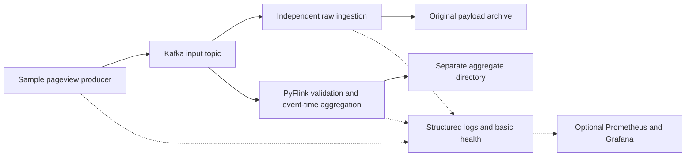

# Engineering guide

This is the central guide to design choices and AI-assisted development. Only documentation exists. Recommendations below are not approved implementations; no prototype or runtime verification has taken place.

## Architecture

Python, Kafka, PyFlink, Docker Compose, local storage, pytest and GitHub Actions are agreed choices. Raw ingestion and aggregation are independent. Direct aggregate output from Flink is preferred over an extra topic.

The brief permits multiple broker, storage and streaming options. Kafka, PyFlink and local files are our choices, rather than technologies dictated by traffic volume. This route does not require AWS, Kinesis, S3, LocalStack or Terraform. Keep the local topology small. Production resilience is separate from this design.

## Technical decisions

All entries below remain open. Record the engineer's choice and supporting evidence here when agreed. Specific watermark delays, idle timeouts and checkpoint intervals are intentionally unset.

| Decision | Alternatives and recommendation for review |
| --- | --- |
| PyFlink API and versions | Table/SQL makes grouping concise; DataStream provides explicit validation and late-event control. Evaluate which meets the agreed policies with the least code. Check a compatible released Python/JVM/Flink/Kafka/connector set before pinning versions. |
| Raw ingestion and format | A small independent Python consumer is a candidate. Compare per-record files with framed segments. Per-record files are simple but numerous; segments need framing and recovery logic. Plain JSONL cannot preserve arbitrary multiline or malformed payloads safely. Keep original bytes separate from storage metadata. |
| Aggregate sink and schema | Prefer a built-in Flink file sink over custom append/recovery logic. JSONL is easy to inspect; CSV and Parquet are alternatives. The required content is postcode, window datetime and count. Proposed fields are `postcode`, `window_start`, `window_end` and `pageview_count`. Agree whether datetime is represented as UTC text or epoch seconds, whether both boundaries are useful, and how files roll and become committed. These are derived output fields, not source fields. |
| Event-time policy | Propose UTC minute boundaries, start inclusive and end exclusive. Agree disorder tolerance, idle-input handling and whether late records are dropped with diagnostics or update earlier results. Corrections complicate append-only output. A quiet stream may not advance event time enough to close its last window. |
| Checkpoints and delivery | Review checkpoint storage/interval, producer acknowledgement/retry settings, raw write/offset ordering and restart limits. Durable raw writes before offset commits can still replay after failure. Do not promise pipeline-wide exactly once. |
| Validation | Enforce required types without treating booleans as integers. Agree extra fields, empty values, numeric/timestamp ranges, malformed records and diagnostics. Accept the supplied partial postcode and scheme-less webpage. Full postcode validation, scheme requirements and non-negative limits are not stated requirements. |
| Local setup | A single broker, one input partition and Flink parallelism 1 are candidates, not requirements. Agree persistent mounts, retention and disk/resource budgets. Verify Windows filesystem access. |
| Test completion and CI | Compare bounded Kafka inputs with observable continuous-job completion. Use the same processing logic as the real application. Bounded tests alone do not establish continuous or idle-stream behaviour. Agree readiness, deadlines, watermark observations and runner limits. |

## Correctness and testing

Base DQ requirements live in [SPEC.md](../SPEC.md#base-data-quality-requirements). Keep their implementation small: validation functions, structured diagnostic counts and independent checks in the scenario harness. No additional DQ framework, service or Kafka topic is needed by the current scope. The raw archive already preserves rejected payloads; a separate quarantine store would need a demonstrated reason.

Recommend rejecting blank postcode/webpage strings, while accepting the supplied partial postcode and scheme-less webpage. Agree this policy and timestamp representability/future-skew limits before implementation. Do not use a current-date freshness rule that rejects historical test fixtures. Generic traffic anomaly thresholds and ongoing reconciliation services are later enhancements, not base checks. Counts emitted during recovery may repeat unless their recovery semantics are explicitly defined; scope test diagnostic counts to known runs and test recovery separately.

Preserve Kafka payload bytes without parsing and serialising them again. Test whitespace, Unicode and line breaks. Agree malformed/null payload handling and any archive framing before claiming recovery or byte fidelity.

Event timestamps are epoch seconds. Under the proposed UTC boundary convention, window start is `60 * floor(timestamp / 60)` and end is start + 60. Any internal millisecond conversion must preserve that meaning. Postcode counts are pageview counts, not distinct-user counts.

Out-of-order input may still belong to an open window. Watermarks express progress assumptions, not proof that all records arrived. Idle-input detection can unblock active partitions but does not itself guarantee closure when all input stops. Validate timestamps before they influence watermarks.

Identical payloads do not establish duplicate business events because there is no event ID. Compare counts and record multiplicity, not sets. Kafka offsets can identify replays without changing source fields.

A scenario defines its name, input events, expected raw output, expected aggregates and expected validation/errors. The harness prepares isolated resources, publishes to Kafka, exercises the real streaming application, waits for observable results, compares records, reports and cleans up even after failure. Use explicit expected values rather than a second aggregation implementation. On timeout, capture useful progress and safe diagnostics.

Unit tests cover validation, timestamp conversion and applicable window calculations. Integration tests cover Kafka connectivity, publishing/consumption, Flink and files. Scenario coverage includes normal input, minute boundaries, multiple postcodes, invalid/missing values, out-of-order/late events and quiet streams. Add recovery cases as persistence policies are agreed.

Checkpoint state, Kafka offsets and external file commits are different boundaries. Verify restart behaviour and finished-file visibility before claiming durability or duplicate-free output. Independent consumers do not provide an atomic transaction across raw and aggregate output. Local disk storage does not protect against disk loss.

## AI-assisted development

Start from the requirement and acceptance criteria. AI can research alternatives and suggest changes; the engineer selects the design and reviews the result.

1. Agree the specification and a small milestone scope before implementation.
2. Use test-first development where practical for validation and processing logic.
3. Implement the simplest readable change, with minimal dependencies.
4. Challenge generated code: inspect assumptions, boundary cases, failure paths and connector behaviour.
5. Run relevant checks against independently specified expectations. Passing tests do not validate assumptions shared by the code and tests.
6. Update documentation and report evidence, limitations and unresolved issues. Keep proposed production improvements distinct from local capabilities.
7. The engineer reviews and commits. AI must not commit, push, create/merge PRs or manufacture history.

Use clear comments and accurate explanations. Do not disguise AI assistance or introduce deliberate mistakes. No implementation lessons have been observed yet; add brief lessons with supporting evidence as milestones finish.

## Observability and production considerations

Start with structured logs, errors, job health, consumer progress and output inspection. Even low traffic can conceal a stuck watermark or failed writer. Avoid logging payloads by default.

Optional Prometheus/Grafana should reuse existing Flink/Kafka integrations. Cover incoming and processing throughput, invalid events, aggregation output, consumer lag where available, job health, errors and checkpoint/recovery status. Agree any alerts separately. Document unavailable signals and avoid labels based on individual users, postcodes or URLs.

Production improvements are not implemented or required locally. Measure peaks, skew, state, lag, file counts and disk growth before scaling. Host failure tolerance would require resilient broker/storage/checkpoint arrangements and tested restoration. Real-data use would also require privacy, retention, authentication, access control and secret-management decisions, with explicit cost review for cloud services.

## Deferred incident demonstration

After a healthy tested baseline, an optional separate branch can introduce a controlled data-quality defect. Exercise a previously uncovered scenario and detect the issue through independent validation or monitoring. Agent Forge would collect safe logs, metrics and relevant source, identify a likely root cause and recommend a fix and regression test. Human approval must precede a fix branch or PR; existing agent Git restrictions still apply. No integration or fault injection is authorised now.

## Technical discussion and references

Be ready to explain why event time suits delayed visits, why raw ingestion is independent, how the API choice affects readability, how tests observe completion, what recovery guarantees were demonstrated and what production requirements would change the design. Support answers with actual decisions and test results as they become available.

Earlier documentary research used the official [PyFlink overview](https://nightlies.apache.org/flink/flink-docs-release-2.0/docs/dev/python/overview/), [file sink](https://nightlies.apache.org/flink/flink-docs-release-2.0/docs/connectors/datastream/filesystem/), [watermarks](https://nightlies.apache.org/flink/flink-docs-release-2.0/docs/dev/datastream/event-time/generating_watermarks/) and [windows](https://nightlies.apache.org/flink/flink-docs-release-2.0/docs/dev/datastream/operators/windows/) documentation. These explain mechanisms, not a selected version or tested local configuration. Recheck documentation and connector support for the chosen release before implementation.
